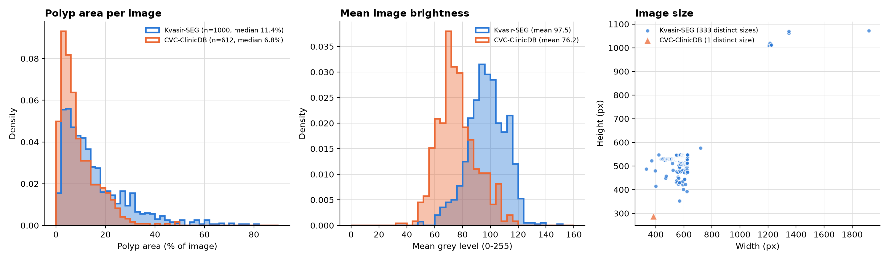
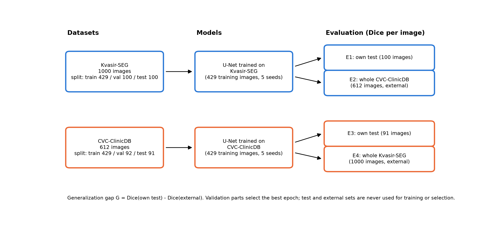
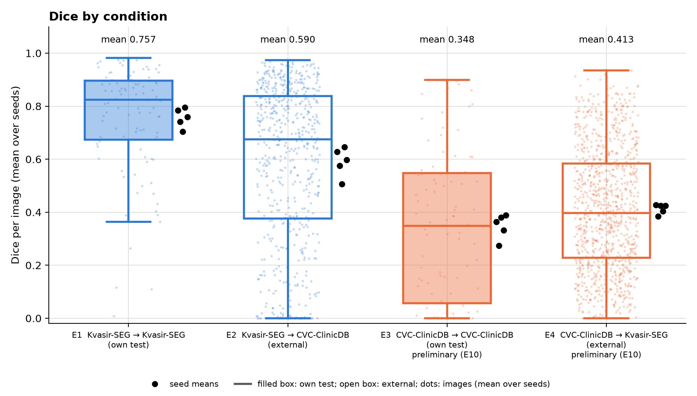
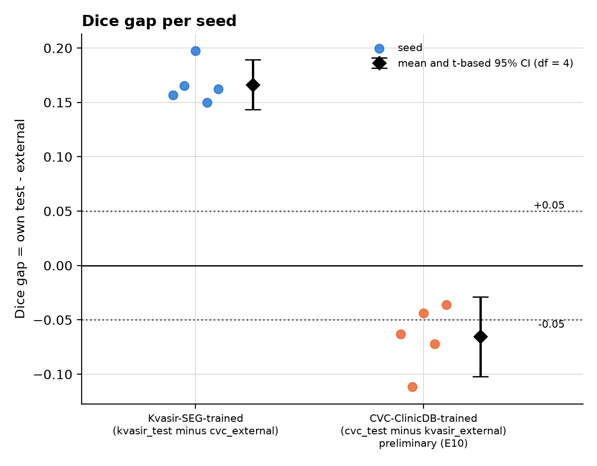
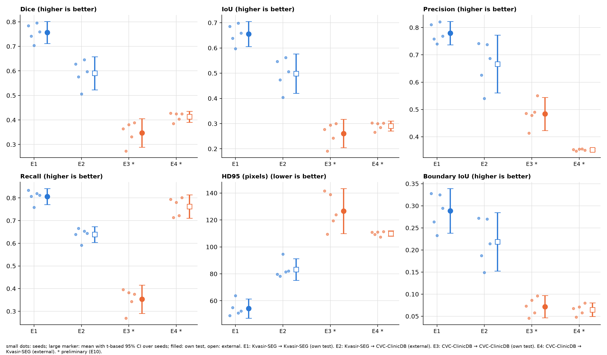
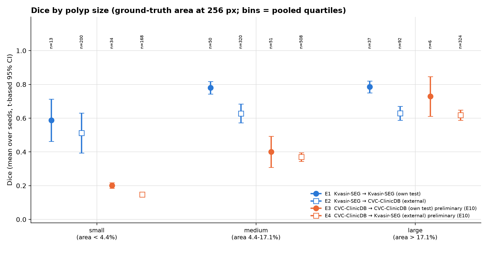
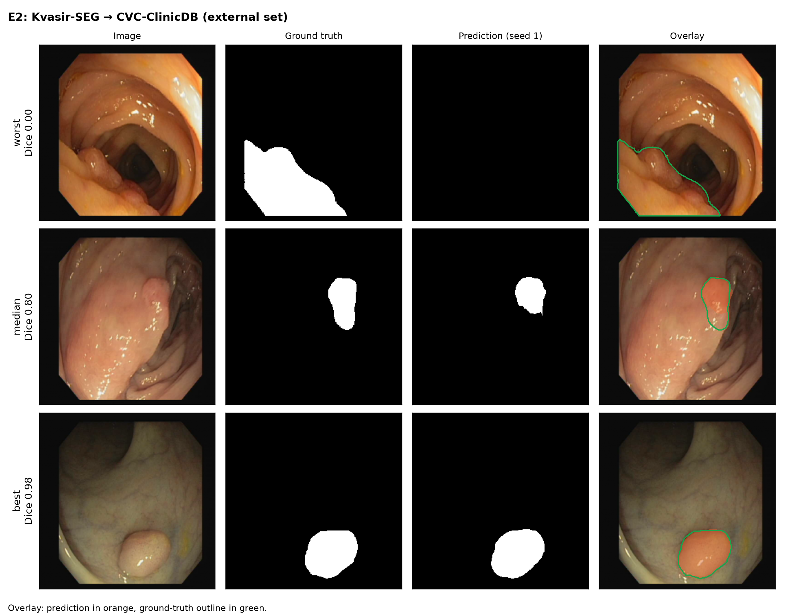

# Cross-Dataset Generalization of U-Net for Colorectal Polyp Segmentation

> **Status: research code in progress, not peer reviewed.** The experiment (equal training-set size, 5 seeds, 10 runs) is complete; the CVC-ClinicDB-trained models did not reach a usable within-dataset baseline, see [Results](#12-results). No claim in this document goes beyond the evidence listed in it.

## 1. Abstract

This repository studies how a U-Net trained for binary colorectal polyp segmentation behaves when it is applied, without fine-tuning, to a second public colonoscopy dataset. The two datasets are Kvasir-SEG (1,000 images) and CVC-ClinicDB (612 video frames). Quality is measured by the Dice coefficient per image, together with IoU, precision, recall, HD95 and Boundary IoU.

Both datasets are trained on the same number of images (429) with 5 seeds. The Kvasir-SEG-trained model reached a mean Dice of 0.757 on its own test set and 0.590 on the whole CVC-ClinicDB set; the generalization gap is 0.166 (95% t-interval over seeds [0.143, 0.189]; cluster bootstrap [0.084, 0.252]). The reverse direction cannot be interpreted: the CVC-ClinicDB-trained models reached only 0.348 on their own test set and 0.413 on Kvasir-SEG (gap −0.065), and their validation Dice stayed below 0.5 for every seed (error E10), so no reliable within-dataset baseline exists.

## 2. Research question

**How much does the per-image Dice of a U-Net change when a model trained on one polyp dataset is evaluated on the other dataset, compared with its performance on held-out data of its own training dataset, and does this change exceed a practically relevant threshold?**

The practical thresholds on the Dice gap are δ = 0.05 (primary), and δ = 0.03 and 0.10 (sensitivity analyses). The thresholds are taken from the project methodology and were fixed before the statistics in this repository were computed. The experiment measures the combined effect of everything that differs between the two datasets; it cannot attribute a change to a single factor such as brightness, resolution or annotation style.

## 3. Motivation and background

Segmentation models for colonoscopy are usually reported on a test split of the dataset they were trained on. Frames from the same patient or the same video sequence are nearly identical, so a within-dataset score can be optimistic, and a model may not transfer to other endoscopes, hospitals or annotation protocols. U-Net [1] is a standard baseline architecture for biomedical segmentation; this project uses it as a controlled baseline to quantify the transfer gap between two widely used polyp datasets [2, 3].

## 4. Experimental objectives

1. Build an auditable, reproducible data pipeline: dataset audit, fixed splits, duplicate and leakage checks (`audit/`, `outputs/`).
2. Measure within-dataset and cross-dataset Dice per image for both transfer directions (`train/`, `runs_equal/`).
3. Control for the size of the training set: both datasets are trained on the same number of images (429).
4. Quantify uncertainty separately between training runs (seeds) and between images (video sequences resampled together).

## 5. Datasets

| | Kvasir-SEG | CVC-ClinicDB |
|---|---|---|
| Content | 1,000 polyp images with binary masks | 612 colonoscopy frames with binary masks |
| Image size | 333 distinct sizes, 332-1920 px wide and 352-1072 px high | 384 × 288 (single size) |
| Mask files | JPEG (all 1,000 masks contain values other than 0/255) | PNG (138 of 612 masks contain values other than 0/255) |
| Grouping | none available | frames from video sequences; the metadata file used here lists **29** sequences (the original description reports 31 sequences from 23 patients [4]; the difference is unresolved) |
| Official source | https://datasets.simula.no/kvasir-seg/ [2] | https://polyp.grand-challenge.org/CVCClinicDB/ [3] |



Audit results (`outputs/audit_report.md`, `outputs/summary.json`): all 1,000 and 612 image-mask pairs were found, no file is corrupt, no mask is empty, and no image-mask size mismatch exists. After binarisation (`value > 127`) every mask has exactly two classes.

**Data terms.** CVC-ClinicDB is restricted to research and educational use and forbidden for commercial use; the images belong to Hospital Clínic, Barcelona, and the masks to the Computer Vision Center, Barcelona (official page, accessed during preparation of this README). The Kvasir-SEG terms could not be verified automatically; check the official page before redistributing anything derived from it. Raw data is **not** in this repository (`data/` is git-ignored). The repository does contain figures that show individual frames of the datasets: qualitative examples (`runs*/*/examples_*.png`, `fig08_examples_*.png`), the annotation panels (`error_analysis/frames/`) and the preprocessing and near-duplicate figures in `outputs/`. They are included for research and educational purposes only. The copyright of the images remains with the dataset owners (Hospital Clínic, Barcelona and the Computer Vision Center for CVC-ClinicDB; the authors of Kvasir-SEG); the figures must not be used commercially. If the Kvasir-SEG terms turn out to be stricter, they should be removed.

**Provenance of the archives used here.** The archives are listed with SHA-256 checksums in `data/data_checksums.sha256`. The CVC-ClinicDB archive contains `metadata.csv` (sequence IDs) and `class_dict.csv` next to the image folders. Their origin is not documented in the archive; they are treated as third-party metadata.

## 6. Methodology and model architecture

- **Model:** U-Net with four down/up-sampling stages, 3×3 convolutions with batch normalisation, transposed-convolution up-sampling and a 1×1 output layer (`train/model.py`); 32 base channels, 7,763,041 trainable parameters; one logit per pixel.
- **Task:** binary semantic segmentation (polyp / background) at 256 × 256 pixels. Metrics describe pixel overlap and boundary agreement; no object-level detection metric (such as per-polyp hit rate) is computed.
- **Loss:** binary cross-entropy plus soft Dice (`train/metrics.py`).
- **Optimiser:** AdamW [5] with a plateau learning-rate scheduler driven by validation Dice.

## 7. Experimental design

| Direction | Training data | Model selection (validation) | Test |
|---|---|---|---|
| **A. Within dataset** | train split of dataset X | val split of dataset X | test split of dataset X |
| **B. Cross dataset (no fine-tuning)** | train split of dataset X | val split of dataset X | **all** images of dataset Y |
| **C. Reverse transfer** | train split of Y | val split of Y | all images of X |

Within-dataset evaluation (A) answers how well the model works on unseen images from the same source. Cross-dataset evaluation (B, C) applies the frozen model to a different source; it estimates robustness to a change of data source. The generalization gap is **G = Dice(own test) − Dice(external)**. The external dataset is never read during training, checkpoint selection or learning-rate scheduling (`train/engine.py` loads only the train and val parts).

**Conditions.** E1 = Kvasir-SEG → Kvasir-SEG test; E2 = Kvasir-SEG → CVC-ClinicDB (whole set); E3 = CVC-ClinicDB → CVC-ClinicDB test; E4 = CVC-ClinicDB → Kvasir-SEG (whole set).



**Splits** (`outputs/splits/`, fixed seed 42, generated by `python -m audit.run`):

| Dataset | Method | Train / val / test | Notes |
|---|---|---|---|
| Kvasir-SEG | random, seeded | 800 / 100 / 100 images | the dataset's own `train.txt` / `val.txt` (880 / 120) are not used |
| CVC-ClinicDB | whole video sequences assigned to one part | 429 / 92 / 91 frames (19 / 5 / 5 sequences) | no sequence appears in two parts (checked) |

**Equal training size.** To remove the difference in training-set size, the Kvasir-SEG model is trained on a fixed random subset of 429 of its 800 training images (`outputs/splits/kvasir_train_subset_429_seed42.json`, drawn once with seed 42 and used for every seed), which equals the 429 training frames of CVC-ClinicDB. Validation and test sets are not subsampled.

| Setting | Value |
|---|---|
| Training images | 429 per dataset |
| Seeds | 1-5 (10 runs) |
| Early stopping | patience 15, not before epoch 50 (`min_epochs`; see [limitations](#16-limitations-and-threats-to-validity)) |
| Config / output | `configs/equal_size.yaml` → `runs_equal/`, `results_equal/`, `final_results/` |

## 8. Data preprocessing and augmentation

Preprocessing (`audit/preprocess.py`, identical for both datasets and for training and evaluation): resize to 256 × 256 (Pillow bilinear for images, nearest neighbour for masks), binarise masks with `value > 127`, scale pixels to [0, 1]. No dataset-specific normalisation is used. Resizing to a square changes the aspect ratio (median width/height 1.16 for Kvasir-SEG, 1.33 for CVC-ClinicDB). The preprocessing check (`outputs/fig_preprocessing_*.png`) found a maximum polyp-area change of 0.18 percentage points and no mask that became empty.

Augmentation (training only, applied on the fly, no extra images are stored): horizontal and vertical flip (p = 0.5 each), and with p = 0.5 a random rotation up to ±15° with zoom 0.9-1.1. There is no brightness or colour augmentation.

## 9. Training configuration

| Setting | Value | Setting | Value |
|---|---|---|---|
| Optimiser | AdamW, lr 1e-3, weight decay 1e-4 | Batch size | 16 |
| LR schedule | halve after 5 epochs without val-Dice gain | Max epochs | 100 |
| Early stopping | patience 15 on val Dice, from epoch 50 | Threshold | 0.5 |
| Mixed precision | on (CUDA only) | Selection rule | epoch with highest val Dice |

Hyper-parameters were set by the implementer a priori and were **not tuned**; they are not taken from a published protocol. Every run records its seed, best epoch, configuration, Python and library versions, and the Git commit in `runs_equal/*/run.json`.

## 10. Evaluation metrics

Computed per image on the 256 × 256 prediction (threshold 0.5) and then averaged (definitions: [`final_results/METRICS.md`](final_results/METRICS.md)): Dice = 2TP/(2TP+FP+FN) (both masks empty → 1), IoU, precision, recall, HD95 between mask boundaries in pixels (362.04 for an empty prediction), Boundary IoU with a 5 px band [6], and the miss rate (share of empty predictions).

**Statistics.** For each condition the mean is first taken over images (per seed). The gap G is computed per seed; the primary 95% interval is t-based over seeds (df = number of seeds − 1), the secondary one is a cluster bootstrap (10,000 resamples) in which whole video sequences are resampled for CVC-ClinicDB. Decision rule on a CI [L, U] and threshold δ: L > δ → meaningful drop; U < −δ → meaningful increase; [L, U] ⊂ [−δ, δ] → equivalence; otherwise inconclusive.

## 11. Training and evaluation commands

```bash
# environment (Python >= 3.9; PyTorch only for training)
pip install -r requirements.txt                  # audit and tests
pip install -r requirements/train.txt            # adds PyTorch; choose the CUDA build for your GPU first, see docs/SETUP_ru.md

# data: place the two archives under data/ as described in "Reproducibility", then verify
python -m audit.run --config config.yaml         # audit, fixed splits, outputs/
python -m train.verify_data                      # file hashes equal the audited data
python -m pytest -q                              # unit tests (CPU only)

# training and evaluation of the experiment (resumable; results in runs_equal/)
python -m train.check_gpu                        # shows whether a GPU is used
python -m train.run_all --config configs/equal_size.yaml --smoke          # 2-epoch check, runs_smoke/
python -m train.run_all --config configs/equal_size.yaml --device cuda    # the experiment (10 runs)
python -m train.run_all --config configs/equal_size.yaml --device cpu     # CPU alternative (much slower)
python -m train.evaluate --config configs/equal_size.yaml --run runs_equal/kvasir_seed1   # evaluate one finished run

# statistics, extended metrics, figures, robustness checks
python -m train.collect --config configs/equal_size.yaml                  # statistics, figures, tables -> final_results/
python -m train.original_resolution --config configs/equal_size.yaml      # metrics at the original image size
python -m train.figure_gallery --config configs/equal_size.yaml           # every figure of the experiment -> all_figures/
python -m train.readme_tables                    # checks the tables in this README against final_results/
```

Further instructions (in Russian): [`docs/SETUP_ru.md`](docs/SETUP_ru.md) (installation, GPU), [`docs/EQUAL_SIZE_RUNBOOK_ru.md`](docs/EQUAL_SIZE_RUNBOOK_ru.md), [`docs/RUNPOD_ru.md`](docs/RUNPOD_ru.md).

## 12. Results

All numbers below are generated from the committed result files (`train/readme_tables.py`) and checked by a test. CVC-ClinicDB-trained rows are marked E10: those models did not reach a usable within-dataset baseline.

### Per-run results

Seed 1 was trained on an RTX 3050 under Windows; seeds 2-5 were run by Nursultan Beisenbek in Kaggle on a Tesla T4 under Linux. Training settings and fixed data splits were the same; hardware and software environments differ and are recorded in each `run.json`.

<!-- BEGIN:per_run -->
| Trained on | Seed | Train images | Epochs | Best epoch | Val Dice | Own test Dice (images) | External Dice (images) |
|---|---|---|---|---|---|---|---|
| CVC-ClinicDB | 1 | 429 | 63 | 48 | 0.484 | 0.364 (91) | 0.427 (1000) |
| CVC-ClinicDB | 2 | 429 | 50 | 7 | 0.460 | 0.273 (91) | 0.385 (1000) |
| CVC-ClinicDB | 3 | 429 | 74 | 59 | 0.481 | 0.380 (91) | 0.424 (1000) |
| CVC-ClinicDB | 4 | 429 | 50 | 16 | 0.461 | 0.332 (91) | 0.403 (1000) |
| CVC-ClinicDB | 5 | 429 | 63 | 48 | 0.482 | 0.389 (91) | 0.425 (1000) |
| Kvasir-SEG | 1 | 429 | 100 | 88 | 0.842 | 0.784 (100) | 0.628 (612) |
| Kvasir-SEG | 2 | 429 | 100 | 85 | 0.764 | 0.741 (100) | 0.576 (612) |
| Kvasir-SEG | 3 | 429 | 85 | 70 | 0.709 | 0.703 (100) | 0.506 (612) |
| Kvasir-SEG | 4 | 429 | 87 | 72 | 0.825 | 0.795 (100) | 0.645 (612) |
| Kvasir-SEG | 5 | 429 | 99 | 84 | 0.792 | 0.760 (100) | 0.597 (612) |

**Status: 10 of 10 planned runs finished.**
<!-- END:per_run -->

### Aggregate results over 5 seeds

<!-- BEGIN:results -->
| ID | Trained on (images) | Evaluated on (images) | Dice | IoU | Precision | Recall | HD95 [px] | Boundary IoU | Miss rate |
|---|---|---|---|---|---|---|---|---|---|
| E1 | Kvasir-SEG (429) | Kvasir-SEG test (100) | 0.757 ± 0.036 | 0.656 ± 0.040 | 0.780 ± 0.035 | 0.806 ± 0.029 | 54.2 ± 5.8 | 0.289 ± 0.041 | 0.020 ± 0.010 |
| E2 | Kvasir-SEG (429) | CVC-ClinicDB whole set (612) | 0.590 ± 0.054 | 0.498 ± 0.063 | 0.667 ± 0.085 | 0.639 ± 0.028 | 83.2 ± 6.5 | 0.218 ± 0.053 | 0.091 ± 0.026 |
| E3 | CVC-ClinicDB (429) (weak baseline, E10) | CVC-ClinicDB test (91) | 0.348 ± 0.047 | 0.261 ± 0.045 | 0.484 ± 0.049 | 0.353 ± 0.050 | 126.6 ± 13.5 | 0.072 ± 0.020 | 0.180 ± 0.052 |
| E4 | CVC-ClinicDB (429) (weak baseline, E10) | Kvasir-SEG whole set (1000) | 0.413 ± 0.018 | 0.291 ± 0.016 | 0.352 ± 0.003 | 0.762 ± 0.041 | 109.9 ± 1.7 | 0.065 ± 0.012 | 0.001 ± 0.001 |

Mean ± sample SD over 5 seeds; each seed value is the mean over the images of the evaluation set.
<!-- END:results -->

Generalization gap (Dice), own test minus external:

<!-- BEGIN:gap -->
| Model | Own test | External | Gap G | SD of G | 95% CI (t, df = 4) | 95% CI (cluster bootstrap) | δ = 0.05 | δ = 0.03 | δ = 0.10 |
|---|---|---|---|---|---|---|---|---|---|
| Kvasir-SEG-trained | 0.757 | 0.590 | 0.166 | 0.018 | [0.143, 0.189] | [0.084, 0.252] | meaningful drop | meaningful drop | meaningful drop |
| CVC-ClinicDB-trained (E10) | 0.348 | 0.413 | -0.065 | 0.030 | [-0.102, -0.029] | [-0.256, 0.131] | inconclusive | inconclusive | inconclusive |
<!-- END:gap -->





Gap of every seed, with the machine that trained it (the machine is confounded with seed 1 only):

<!-- BEGIN:gap_by_seed -->
| Seed | Trained on | Kvasir-SEG-trained | CVC-ClinicDB-trained |
|---|---|---|---|
| 1 | RTX 3050 6GB | 0.157 | -0.063 |
| 2 | Tesla T4 | 0.165 | -0.112 |
| 3 | Tesla T4 | 0.198 | -0.044 |
| 4 | Tesla T4 | 0.150 | -0.072 |
| 5 | Tesla T4 | 0.162 | -0.036 |
| mean of seeds 2, 3, 4, 5 | same machine for all of them | 0.169 | -0.066 |
<!-- END:gap_by_seed -->

**Observations.** (i) The Kvasir-SEG-trained model scores 0.757 on its own test set and 0.590 on CVC-ClinicDB. The gap of 0.166 has a t-interval [0.143, 0.189] that lies entirely above δ = 0.05, 0.03 and 0.10; the cluster bootstrap interval [0.084, 0.252] lies above 0.05 and 0.03 but does not decide 0.10. (ii) The CVC-ClinicDB-trained models score 0.348 on their own test set and 0.413 on Kvasir-SEG; they do better on the other dataset than on their own test set. This points to a weak within-dataset baseline (validation Dice 0.460-0.484 for all seeds, selected epochs between 7 and 59), not to good generalization; **no statement about reverse-direction generalization is supported.** (iii) The t-interval over seeds describes variation between training runs for fixed test sets. The cluster bootstrap also resamples images and video sequences, is wider ([0.084, 0.252] for the Kvasir-SEG-trained model, [-0.256, 0.131] for the CVC-ClinicDB-trained models) and does not decide the CVC-ClinicDB direction. (iv) Excluding seed 1, the only seed trained on a different machine, changes the gaps by less than 0.005 (0.169 and −0.066 vs 0.166 and −0.065). (v) Recomputing every metric at the original image resolution instead of 256 × 256 changes the mean Dice by at most 0.001 and leaves the gaps unchanged ([`results_equal/original_resolution/README.md`](results_equal/original_resolution/README.md)).

The five-seed re-evaluation from the saved weights is collected in [`final_results/README.md`](final_results/README.md) (9,975 image-run records, all seven metrics). Both numerical acceptance checks passed; the maximum absolute Dice deviation from the stored evaluations is below 0.002.

## 13. Error analysis

Quantitative indicators (nothing here is a manual annotation):

<!-- BEGIN:errors -->
- Kvasir-SEG-trained model on CVC-ClinicDB (E2): 199 of 612 frames have seed-averaged Dice < 0.5.
- Share of images with an empty prediction (miss rate): E1 2.0%, E2 9.1%, E3 18.0%, E4 0.1%.
- Spearman ρ between per-image Dice and ground-truth polyp area, Kvasir-SEG-trained on CVC-ClinicDB: 0.21 (n = 612; descriptive).
- Spearman ρ between per-image Dice and ground-truth polyp area, CVC-ClinicDB-trained on Kvasir-SEG: 0.79 (n = 1000; descriptive).

Dice by ground-truth polyp size (bins are quartiles of the area at 256 px over all evaluated images; mean ± SD over seeds; n = images):

| ID | small (< 4.4% of image) | medium (4.4-17.1%) | large (> 17.1%) |
|---|---|---|---|
| E1 | 0.587 ± 0.101 (n = 13) | 0.780 ± 0.030 (n = 50) | 0.785 ± 0.028 (n = 37) |
| E2 | 0.512 ± 0.095 (n = 200) | 0.628 ± 0.044 (n = 320) | 0.629 ± 0.034 (n = 92) |
| E3 | 0.201 ± 0.014 (n = 34) | 0.400 ± 0.074 (n = 51) | 0.729 ± 0.095 (n = 6) |
| E4 | 0.148 ± 0.006 (n = 168) | 0.370 ± 0.020 (n = 508) | 0.618 ± 0.024 (n = 324) |
<!-- END:errors -->





Dice is lowest for small polyps in every condition. The CVC-ClinicDB-trained models are weakest there (0.201 on E3, 0.148 on E4) and return an empty prediction for 18.0% of their own test frames; the Kvasir-SEG-trained models show a smaller size dependence (0.512 on small vs 0.628 on medium polyps in E2). **Manual categorisation of failure cases is pending.** Create the annotation material for this experiment with `python -m train.extended errors --config configs/equal_size.yaml` (it writes `error_analysis_equal/`: frames, two blank annotator sheets, `CATEGORIES.md`); after both sheets are filled run `python -m train.analyze_errors --config configs/equal_size.yaml` for Cohen's κ.

## 14. Reproducibility

| Item | State |
|---|---|
| Seeds | recorded in `run.json`; Python, NumPy, PyTorch seeded; GPU kernels are not bit-deterministic unless `training.deterministic: true` |
| Checkpoints | best epoch by validation Dice: `runs_equal/<dataset>_seed<N>/best.pt` (31 MB each, tracked in Git; the repository pack is about 293 MB, so consider Git LFS or release assets before publishing) |
| Training environment | Seed 1: Windows 11, RTX 3050, Python 3.14.3, PyTorch 2.14.1+cu126, NumPy 2.4.3. Seeds 2-5: Kaggle Linux, Tesla T4, Python 3.13.15, PyTorch 2.11.0+cu128, NumPy 2.1.3. |
| Analysis environment | Linux CPU; exact versions are recorded in `final_results/MANIFEST.json` (`requirements/lock.txt` documents a macOS / Python 3.9 / PyTorch 2.8 set that was used for development and tests) |
| Commit of each run | `git_commit` in `run.json`; seed 1 and most Kaggle runs have `git_dirty: true` (`kvasir_seed2` has `false`); that flag alone does not establish which files changed |
| Re-computation | recomputed Dice reproduces the stored per-image Dice (max abs. difference 0.0019, `final_results/tables/acceptance_checks.json`); every file of `final_results/` is listed with its SHA-256 in `MANIFEST.json` |
| Hardware | training: GPU recommended (about 10-20 s per epoch on the RTX 3050); `--device cpu` works but is much slower |

**Data placement** (paths in `config.yaml`):

```
data/kvasir_seg/Kvasir-SEG/Kvasir-SEG/{images,masks}      1000 .jpg each
data/cvc_clinicdb/PNG/{Original,"Ground Truth"}            612 .png each, plus metadata.csv
```

## 15. Repository structure

```
config.yaml, train_config.yaml, configs/   settings (audit; default training settings; equal-size experiment)
audit/       dataset audit, fixed splits, duplicate and leakage checks
train/       model, training, evaluation, statistics, extended metrics, figures, collection
tests/       unit and end-to-end tests on small synthetic data (CPU)
notebooks/   audit.ipynb (the audit step by step)
outputs/     audit report, per-image statistics, fixed splits
runs_equal/  one folder per trained model of the experiment: logs, per-image Dice, best.pt
results_equal/, final_results/   statistics, figures, tables and the manifest of the experiment
all_figures/ every figure of the experiment sorted by topic, with an index ([`all_figures/README.md`](all_figures/README.md))
runs/, results/, error_analysis/   an earlier preliminary run set, kept for the record (see Limitations); not used for the conclusions
docs/        instructions (Russian), research log, error log, validity audit, task plan
```

## 16. Limitations and threats to validity

The full audit with evidence and recommended fixes is in [`docs/validity_audit.md`](docs/validity_audit.md). The main points:

1. **CVC-ClinicDB-trained models are not usable as a baseline** (E10): their own-test Dice is below their Dice on the other dataset, validation Dice stays below 0.5, and the selected epochs vary between seeds.
2. **Leakage control is partial.** Kvasir-SEG has no patient or sequence information; CVC-ClinicDB is split by video sequence, not by patient (23 patients for 29-31 sequences), so patient-level overlap between train and test cannot be excluded. Near-duplicates were checked with a perceptual hash (7 pairs inside Kvasir-SEG, 183 inside CVC-ClinicDB, none between the datasets at a distance of at most 4 bits); only two pairs were reviewed by hand.
3. **Small and correlated test sets.** The CVC-ClinicDB test set has 91 frames from 5 sequences; its bootstrap interval is very wide.
4. **A preliminary run set preceded this experiment and shaped one setting.** An earlier set of runs (Kvasir-SEG trained on 800 images, CVC-ClinicDB on 429, 3 seeds; `runs/`, `results/`, `error_analysis/`) was done before the equal-size design. In it the Kvasir-SEG-trained model scored 0.822 on its own test set and 0.655 on CVC-ClinicDB (gap 0.167). It is not used for the conclusions above. The rule `min_epochs: 50` was chosen from its training curves after its test and external results were already known, so it is an amendment, not a pre-specified rule. The hashes recorded in its `run.json` files refer to a Git history that was later rewritten; [`docs/history_rewrite_map.csv`](docs/history_rewrite_map.csv) maps them to the current ones.
5. **Own-test and external sets are different images.** G mixes domain shift with differences in difficulty between the evaluation sets.
6. **Seeds and machines.** Five seeds were trained on two machines (seed 1 and seeds 2-5); excluding seed 1 changes the gaps by less than 0.005, but hardware and seed cannot be separated for seed 1. The t-interval over seeds ignores the finite size of the test sets; the cluster bootstrap is the more conservative statement.
7. **The origin of the sequence count (29 vs 31) and of `metadata.csv` is unresolved.**

## 17. References

1. O. Ronneberger, P. Fischer, T. Brox. *U-Net: Convolutional Networks for Biomedical Image Segmentation.* MICCAI 2015, LNCS 9351, pp. 234-241. arXiv:[1505.04597](https://arxiv.org/abs/1505.04597).
2. D. Jha, P. H. Smedsrud, M. A. Riegler, P. Halvorsen, T. de Lange, D. Johansen, H. D. Johansen. *Kvasir-SEG: A Segmented Polyp Dataset.* MultiMedia Modeling (MMM) 2020, LNCS 11962, pp. 451-462. DOI [10.1007/978-3-030-37734-2_37](https://doi.org/10.1007/978-3-030-37734-2_37); arXiv:[1911.07069](https://arxiv.org/abs/1911.07069).
3. J. Bernal, F. J. Sánchez, G. Fernández-Esparrach, D. Gil, C. Rodríguez, F. Vilariño. *WM-DOVA maps for accurate polyp highlighting in colonoscopy: Validation vs. saliency maps from physicians.* Computerized Medical Imaging and Graphics 43 (2015) 99-111. DOI [10.1016/j.compmedimag.2015.02.007](https://doi.org/10.1016/j.compmedimag.2015.02.007). The CVC-ClinicDB page asks to cite this paper.
4. D. Vázquez, J. Bernal, et al. *A Benchmark for Endoluminal Scene Segmentation of Colonoscopy Images.* Journal of Healthcare Engineering 2017, 4037190. DOI [10.1155/2017/4037190](https://doi.org/10.1155/2017/4037190); arXiv:[1612.00799](https://arxiv.org/abs/1612.00799). Source of the figures "31 sequences, 23 patients".
5. I. Loshchilov, F. Hutter. *Decoupled Weight Decay Regularization.* ICLR 2019. arXiv:[1711.05101](https://arxiv.org/abs/1711.05101).
6. B. Cheng, R. Girshick, P. Dollár, A. C. Berg, A. Kirillov. *Boundary IoU: Improving Object-Centric Image Segmentation Evaluation.* CVPR 2021. DOI [10.1109/CVPR46437.2021.01508](https://doi.org/10.1109/CVPR46437.2021.01508); arXiv:[2103.16562](https://arxiv.org/abs/2103.16562).

## 18. Citation

Authors: Artur Jaxygaliyev, Nursultan Beisenbek. If you use this code, cite the repository using [`CITATION.cff`](CITATION.cff) (GitHub shows a "Cite this repository" button), and cite the dataset publications [2, 3] and U-Net [1]. The repository has no DOI and has not been published in a peer-reviewed venue.

## 19. License

The source code is released under the [MIT License](LICENSE). The datasets are **not** covered by it and keep their own terms (see [Datasets](#5-datasets)); the trained weights and figures derived from the datasets should be used under those terms.
